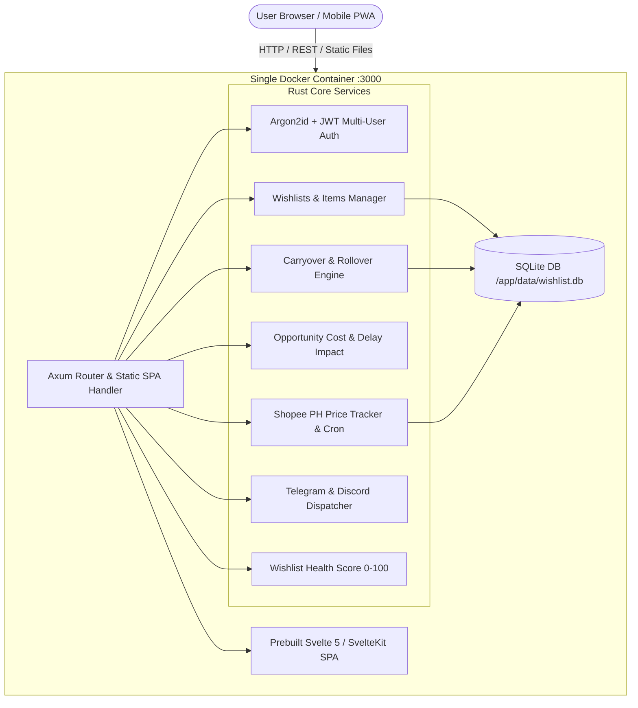

# 🇵🇭 Wishlist Manager PH

> **Self-Hosted Anti-Impulse Buying, Budget Planner & Shopee Philippines Price Tracker**  
> Tailored for Philippine salary earners (PHP 18,000 monthly baseline, PHP 2,000–3,000 wishlist budget) managing non-essential purchases and enforcing disciplined financial planning.

---

## 📑 Table of Contents
1. [Key Features](#-key-features)
2. [Architecture](#-architecture)
3. [Quick Start with Docker & CasaOS](#-quick-start)
4. [Environment Variables](#-environment-variables)
5. [Needs vs. Wants & Priority System](#-needs-vs-wants--priority-system)
6. [Budget Rollover & Purchase Advisor Engine](#-budget-rollover--purchase-advisor-engine)
7. [Shopee Philippines Tracker](#-shopee-philippines-tracker)
8. [Philippines Shopping Sale Calendar](#-philippines-shopping-sale-calendar)
9. [CSV Import & Export Format](#-csv-import--export-format)
10. [REST API Endpoints](#-rest-api-endpoints)
11. [Troubleshooting & FAQ](#-troubleshooting)
12. [Roadmap](#-roadmap)

---

## ✨ Key Features

- **Needs vs. Wants Intentional Classification**: Clearly tag every item as an essential `Need` or non-essential `Want`. The recommendation engine blocks impulse buys if essential needs are compromised.
- **Multiple Wishlists with Independent Budgets**: Create distinct boards (e.g. *Personal Tech*, *Home Improvement*, *Hobby & RC*, *Family*) with dedicated monthly budgets and separate carryover ledgers.
- **Automatic Budget Carryover (Rollover)**: Unused wishlist allocations (e.g., PHP 3,000 budget minus PHP 1,000 spent = PHP 2,000 carryover) automatically accumulate into following months, enabling big-ticket planning without debt.
- **Buy Delay Impact Calculator**: Real-time projection showing: *"If I buy this item now, it delays higher-priority goals and essential needs by X months"*.
- **"What Should I Buy?" & "Should I Buy This?" AI Advisor**: Algorithmic scoring analyzing current wallet cash, discount depths, and opportunity costs.
- **Wishlist Health Score (0–100)**: Evaluates savings discipline, wait times, and impulse control.
- **Shopee Philippines Tracker**: URL parser extracting item and shop IDs, price history recording, lowest recorded alerts, and price drops.
- **PH Shopping Festival Calendar**: Tracks Payday Sales (15th and 30th) and Mega Double-Digit events (9.9, 10.10, 11.11, 12.12).
- **Multi-Channel Alerts**: In-App Notification Center, Telegram Bot messages, and Discord Webhooks.
- **Post-Purchase Happiness Metric**: 1-week, 1-month, and 3-month satisfaction & regret check-ins.
- **Single-Container Lightweight Deployment**: High-performance Rust Axum backend serving compiled Svelte 5 / SvelteKit static SPA with embedded SQLite (WAL mode). Compatible with ARM64 (Raspberry Pi) and AMD64.

---

## 🏗 Architecture



---

## 🚀 Quick Start & Easy Install

### 1. Docker Compose (One-Click Setup)

Create a `docker-compose.yml` file anywhere on your system:

```yaml
services:
  wishlist-manager:
    image: ghcr.io/janlofredy/wishlist-manager-ph:latest
    container_name: wishlist-manager-ph
    restart: unless-stopped
    ports:
      - "3000:3000"
    environment:
      - PORT=3000
      - DATA_DIR=/app/data
      - DATABASE_URL=sqlite:/app/data/wishlist.db?mode=rwc
      - JWT_SECRET=change-this-to-a-very-secure-random-secret-in-production
      - TELEGRAM_BOT_TOKEN=
      - TELEGRAM_CHAT_ID=
      - DISCORD_WEBHOOK_URL=
    volumes:
      - ./data:/app/data
    healthcheck:
      test: ["CMD", "curl", "-f", "http://localhost:3000/api/system/sale-calendar"]
      interval: 30s
      timeout: 5s
      retries: 3
      start_period: 5s
```

Run the container:

```bash
docker compose up -d
```

Open `http://localhost:3000` (or `http://<your-server-ip>:3000`) in your browser. The first user you register automatically receives the **Admin** role!

---

### 2. CasaOS Installation

1. Open your **CasaOS** dashboard.
2. Click **App Store** -> **Custom Install**.
3. Choose **Import** and paste the contents of [`casaos.json`](file:///Users/janlofredy/Documents/antigravity/epic-hypatia/casaos.json) or configure manually:
   - **Image**: `wishlist-manager-ph:latest` (or built locally)
   - **Web UI Port**: `3000`
   - **Volume**: `/DATA/AppData/wishlist-manager/data` -> `/app/data`
   - **Environment Variables**:
     - `DATABASE_URL`: `sqlite:/app/data/wishlist.db?mode=rwc`
     - `PORT`: `3000`
     - `JWT_SECRET`: `your_random_secret_string`
4. Click **Submit**. Wishlist Manager PH will appear on your CasaOS desktop!

---

## ⚙️ Environment Variables

| Variable | Default | Description |
|---|---|---|
| `PORT` | `3000` | Port on which the web server listens. |
| `DATA_DIR` | `/app/data` | Path to persistent storage directory. |
| `DATABASE_URL` | `sqlite:/app/data/wishlist.db?mode=rwc` | SQLite database URI or PostgreSQL connection string. |
| `JWT_SECRET` | `change-me-in-production` | Secret string for HMAC-SHA256 JWT tokens. |
| `TELEGRAM_BOT_TOKEN` | *empty* | Optional Telegram Bot token from @BotFather for mobile price alerts. |
| `TELEGRAM_CHAT_ID` | *empty* | Default Telegram chat ID for system notifications. |
| `DISCORD_WEBHOOK_URL` | *empty* | Optional Discord channel incoming webhook URL. |
| `FRONTEND_DIR` | `/app/frontend_build` | Path to static frontend SPA build directory. |

---

## 🏷 Needs vs. Wants & Priority System

Every item added to your wishlists is designated with an intentional classification and priority:

| Classification | Definition | Advisor Treatment |
|---|---|---|
| **Need** | Essential tools, repair parts, work utilities, or medical/hygiene necessities. | Prioritized first. Has immediate claim on available budget. |
| **Want** | Hobbies, leisure items, aesthetics, or comfort upgrades. | Subject to delay rules, opportunity cost warnings, and sale event waiting periods. |

### Priority Levels

- **Priority 1: Quick Wins (< PHP 1,000)**  
  Affordable items that give immediate satisfaction or quick utility without denting monthly targets.
- **Priority 2: Utility & Hobby (PHP 1,000 – 3,000)**  
  Tools or hobby essentials that fit inside a single month's budget allocation.
- **Priority 3: Mid-Cost Wants (PHP 3,000 – 7,000)**  
  Items requiring 1–2 months of rollover budget accumulation.
- **Priority 4: Large Purchases (> PHP 7,000)**  
  Major purchases requiring 3+ months of rollover discipline.

---

## 💰 Budget Rollover & Purchase Advisor Engine

### Monthly Allocation Baseline
- **Gross Salary**: PHP 18,000
- **Fixed Bills**: PHP 10,000
- **Savings Allocation (20%)**: PHP 3,600 (towards Emergency Fund)
- **Monthly Wishlist Budget**: PHP 3,000
- **Carryover Rule**: `Unused Budget Month N -> Month N+1`

### "What Should I Buy?" Dynamic Algorithm
1. Check available budget (including carryover amount).
2. Rank items by Priority (1 -> 4) and Classification (`Need` -> `Want`).
3. If `current_price <= target_price` or `current_price == lowest_recorded`: Trigger **Buy Now**.
4. If `current_price > avg_price * 1.10`: Trigger **Wait For Sale**.
5. Calculate **Buy Delay Impacts** on remaining active items.

---

## 🛒 Shopee Philippines Tracker

- Paste any Shopee PH listing URL (`https://shopee.ph/...-i.12345.67890`).
- The backend automatically parses the `shopid` and `itemid`.
- Stores timestamped price history snapshots.
- Computes:
  - Lowest Recorded Price
  - Highest Recorded Price
  - 7-Day & 30-Day Moving Averages
  - Percentage Trend vs. Baseline
- Runs a background refresh cron every 24 hours with manual instant-refresh trigger buttons in the UI.

---

## 📅 Philippines Shopping Sale Calendar

Built-in calendar monitoring major Philippine shopping sale windows:
- **Payday Sales**: 15th (Mid-Month) and 30th (Sweldo Day)
- **Double-Digit Mega Sales**: 9.9, 10.10, 11.11, 12.12
- **Holiday Clearance**: Christmas Gift Rush & New Year Sales

Includes voucher recommendations: stacking Free Shipping vouchers, coins cashback, and ShopeePay discount periods.

---

## 📦 CSV Import & Export Format

Wishlist Manager PH supports exporting and importing your wishlist items via CSV spreadsheets:

```csv
priority,item,category,classification,estimated_price,status,target_price
1,Ergonomic Mouse,Desk Setup,Need,1200,Waiting,999
2,Mechanical Keyboard,Desk Setup,Want,2500,Waiting,2000
3,USB-C Hub,Electronics,Need,800,Waiting,650
```

Upload or download your wishlist anytime via **Settings -> Import / Export CSV**.

---

## 📡 REST API Endpoints

### Authentication
- `POST /api/auth/register` — Register new user (first user becomes Admin)
- `POST /api/auth/login` — Sign in and obtain JWT
- `GET /api/auth/me` — Current profile

### Wishlist & Items
- `GET /api/wishlists` — List user's wishlists
- `POST /api/wishlists` — Create wishlist board
- `GET /api/items` — Query items (filter by category, board, classification, status)
- `POST /api/items` — Add new item
- `PUT /api/items/:id` — Update item details
- `DELETE /api/items/:id` — Delete item
- `POST /api/items/:id/purchase` — Mark item as purchased
- `POST /api/items/:id/restore` — Restore purchased item
- `POST /api/items/:id/refresh-price` — Trigger Shopee price refresh
- `GET /api/items/:id/price-stats` — Price moving averages and stats

### Budget & Financial Advisor
- `GET /api/budget/summary` — Full monthly budget and rollover metrics
- `PUT /api/budget` — Update salary, bills, or allocations
- `GET /api/advisor/what-should-i-buy` — Ranked purchase recommendations
- `GET /api/advisor/should-i-buy/:item_id` — Delay impact & opportunity cost analysis
- `GET /api/advisor/health-score` — Wishlist health score (0–100)

### Notifications & System
- `GET /api/system/notifications` — Notification center feed
- `GET /api/system/sale-calendar` — Philippines sale calendar events
- `GET /api/system/settings` — User webhook settings
- `PUT /api/system/settings` — Update Telegram / Discord webhooks
- `POST /api/system/happiness` — Record post-purchase satisfaction reflection
- `GET /api/backups/export/csv` — Download CSV export
- `POST /api/backups/import/csv` — Bulk upload items via CSV
- `GET /api/backups/export/json` — Complete database JSON backup
- `POST /api/backups/preload-starter` — Preload 26 default Philippine items

---

## 🛠 Troubleshooting

1. **Shopee URL shows price error or doesn't update**:  
   Shopee PH uses aggressive bot detection. Wishlist Manager PH utilizes simulated Open Graph headers and API fallback. If an item cannot be automatically parsed, you can enter the current price directly in the item modal or trigger manual price adjustment.
2. **Database Locked in SQLite**:  
   SQLite WAL (Write-Ahead Logging) mode is activated by default. Ensure your volume mount `./data` has read/write permissions for the container process.
3. **Telegram notifications not sending**:  
   Ensure `TELEGRAM_BOT_TOKEN` is passed into container environment variables, and that you have started a chat with your bot before entering your numeric Chat ID.

---

## 🗺 Roadmap

- [ ] Multi-store price comparison (Lazada Philippines & TikTok Shop support)
- [ ] OCR receipt scanning to automatically verify purchase price against target
- [ ] Collaborative family wishlist budget pools with shared allowances
- [ ] Push Notifications via WebPush Service Worker (VAPID)
- [ ] SPayLater 0% interest installment delay cost simulator
